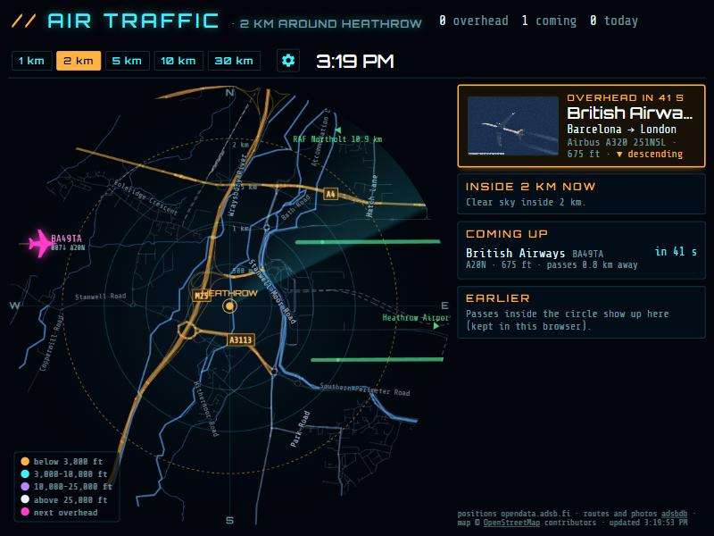

# Air Traffic Radar

A live radar of the planes passing over **your** home: who they are, where they're flying from and to, how low they
are, and which one is next to fly over. A sketched street map underneath shows you exactly where to look.

**[Open the radar](https://lankawithanage.github.io/air-traffic-radar/)**. It starts in demo mode with simulated planes,
so you can try it before setting anything up.



- **The scope:** rings at your chosen range (1, 2, 5, 10 or 30 km, default 2 km). Planes point the way they're flying,
  leave a 3-minute trail, and are coloured by altitude. Planes heading your way show as arrows on the edge, with how
  many seconds until they arrive.
- **Next overhead:** the plane over you now or about to be, with a photo of the actual aircraft when one exists, the
  airline, flight number, type, altitude, climbing or descending, and the route.
- **Lists:** inside the circle now, coming up next, and earlier passes (remembered in your browser).
- **Map:** roads with names and highway numbers, rivers, rail, parks and airport runways from OpenStreetMap. Nearby
  airports are pinned to the edge with their distance.
- **Works anywhere:** phones, PCs, tablets, TVs, and wall-mounted screens in portrait or landscape. Kiosk mode hides
  the buttons.

Everything is free: no paid services and no sign-ups apart from the optional Cloudflare account in step 2.

---

## How it works

```
your browser ──(rounded point + radius)──▶ your own API ──▶ adsb.fi  (aircraft positions, free, open data)
     │                                    (Cloudflare Worker      └─▶ adsb.lol (backup)
     │                                     or api/proxy.py)
     ├──(flight number)──▶ adsbdb.com      (airline, route, aircraft photo; free, no key)
     └──(rounded point)──▶ Overpass API    (OpenStreetMap roads and rivers for the sketch map; free, no key)
```

The free flight-position services don't let web pages call them directly; browsers block it. So live data goes
through a tiny API of your own, which simply asks them and passes the answer back. That's the only setup step.

## Set it up for your home

### 1. Set your location

Open the radar and tap the **⚙ settings** button.

- **Latitude and longitude:** in [Google Maps](https://maps.google.com) on a computer, right-click your house and click
  the numbers at the top of the menu (that copies them, e.g. `51.47060, -0.50100`). Paste them into the
  **Latitude** box; both boxes fill in. On a phone, **Use my current location** works too.
- **Name on the radar:** what the centre is called (default "Home").
- **Range:** how far around home to show. 2 km is the close-up of planes going over the house.

Your location is saved **only in your browser** (localStorage). It is never written into this repository or the page.

### 2. Get your own API (free)

Pick **one**.

#### Option A: Cloudflare Worker (recommended, about 5 minutes, free, always on)

1. Create a free account at [dash.cloudflare.com](https://dash.cloudflare.com/sign-up) (the free Workers plan allows
   100,000 requests a day; the radar uses about 29,000 if left open all day).
2. Go to **Workers & Pages → Create → Create Worker** (choose "Start with Hello World"), give it a name such as
   `air-traffic`, and click **Deploy**.
3. Click **Edit code**, delete everything in `worker.js`, paste the contents of
   [`api/worker.js`](api/worker.js) from this repository, and click **Deploy**.
4. Copy the Worker's address, e.g. `https://air-traffic.YOUR-NAME.workers.dev`.
5. Recommended: keep other websites from using your API. In the Worker, open **Settings → Variables and Secrets →
   Add**, name it `ALLOWED_ORIGINS`, and set it to the address of the page you use, e.g.
   `https://YOUR-NAME.github.io` (several can be separated by commas). Deploy again.
6. In the radar's settings choose **Live: my own API**, paste the Worker address, and **Save**.

Prefer the command line? In the `api/` folder: `npx wrangler login`, edit `ALLOWED_ORIGINS` in
[`api/wrangler.toml`](api/wrangler.toml), then `npx wrangler deploy`.

#### Option B: your own computer (no account at all)

Needs Python 3.8 or newer (nothing to install).

```bash
git clone https://github.com/LankaWithanage/air-traffic-radar.git
cd air-traffic-radar
python api/proxy.py
```

Open **http://localhost:8787**, set your location, choose **Live: my own API**, and enter `http://localhost:8787`.
To open it from other devices on your home network, use `python api/proxy.py --host 0.0.0.0` and visit
`http://<that computer's IP>:8787`.

### 3. Optional: your own copy on GitHub Pages

1. **Fork** this repository (button at the top right on GitHub).
2. In your fork: **Settings → Pages → Build and deployment → Source: Deploy from a branch**, branch `main`, folder
   `/ (root)`, **Save**.
3. After a minute it's at `https://YOUR-NAME.github.io/air-traffic-radar/`. Use that address in `ALLOWED_ORIGINS`.

## Wall screens, TVs and kiosks

Settings can also go in the page address after `#`. Browsers never send that part to any server, so it's a handy
way to set up a screen without a keyboard:

```
https://YOUR-NAME.github.io/air-traffic-radar/#lat=51.4706&lon=-0.5010&api=https://air-traffic.YOUR-NAME.workers.dev&r=2&label=Home&kiosk=1
```

| Setting | Meaning |
|---|---|
| `lat`, `lon` | your location |
| `api` | your API address (from step 2) |
| `r` | range in km: 1, 2, 5, 10 or 30 |
| `label` | name at the centre |
| `kiosk=1` | hide the buttons and mouse pointer |
| `demo=1` | simulated planes |

Treat a bookmarked address like that as private: it contains your location.

## Privacy

- **Your location** stays in your browser. The API, adsb.fi and OpenStreetMap only ever see a point **rounded to two
  decimals (about 1 km)** plus a radius. The exact distance to your house is worked out in your browser.
- **Your API** forwards requests and stores nothing. `ALLOWED_ORIGINS` stops other sites from using it.
- **Lookups:** flight numbers and aircraft codes are sent to adsbdb.com to get routes and photos. Results are cached in
  your browser (routes 7 days, aircraft 30 days).
- **Pass history** ("Earlier") is kept in your browser only. **Settings → Forget passes** clears it.
- No analytics, no cookies, no accounts.

## Data, limits and credits

| Service | Used for | Cost / key | Limits and terms |
|---|---|---|---|
| [adsb.fi](https://adsb.fi) open data | aircraft positions | free, no key | 1 request per second; personal, non-commercial use; credit adsb.fi |
| [adsb.lol](https://adsb.lol) | backup positions | free, no key | dynamic limits (currently about 500 a day without a key) |
| [adsbdb](https://www.adsbdb.com) | airline, route, photo | free, no key | generous rolling limits |
| [airport-data.com](https://www.airport-data.com) | aircraft photos (via adsbdb) | free | photos belong to their photographers |
| [OpenStreetMap](https://www.openstreetmap.org/copyright) via [Overpass](https://wiki.openstreetmap.org/wiki/Overpass_API) | sketch map | free, no key | © OpenStreetMap contributors (ODbL); fair use, cached 30 days per location |

The radar asks your API every 3 seconds while it's open, well inside adsb.fi's limit. Routes come from a
crowd-sourced database and can be out of date. A route that doesn't fit a low pass near you is marked with "?".
Positions come from aircraft that broadcast ADS-B; a few (some military and private flights) don't appear.

If you enjoy the data, consider [feeding adsb.fi](https://adsb.fi) with a cheap USB receiver: feeders get higher limits
and help keep it free.

## Files

| Path | What it is |
|---|---|
| `index.html`, `css/`, `js/` | the radar page (no build step; plain HTML, CSS and JavaScript) |
| `js/geo.js` | distance, closest-approach and pass maths |
| `js/data.js` | settings, your API / demo traffic, route lookups, pass history |
| `js/map.js` | OpenStreetMap sketch map |
| `api/worker.js`, `api/wrangler.toml` | the Cloudflare Worker API |
| `api/proxy.py` | the same API for your own computer; also serves the page |
| `tests/test_geo.mjs` | `node tests/test_geo.mjs` |

## Licence

MIT, see [LICENSE](LICENSE). Map data © OpenStreetMap contributors. Flight data from adsb.fi / adsb.lol, routes and
photos from adsbdb / airport-data.com, under their own terms.
